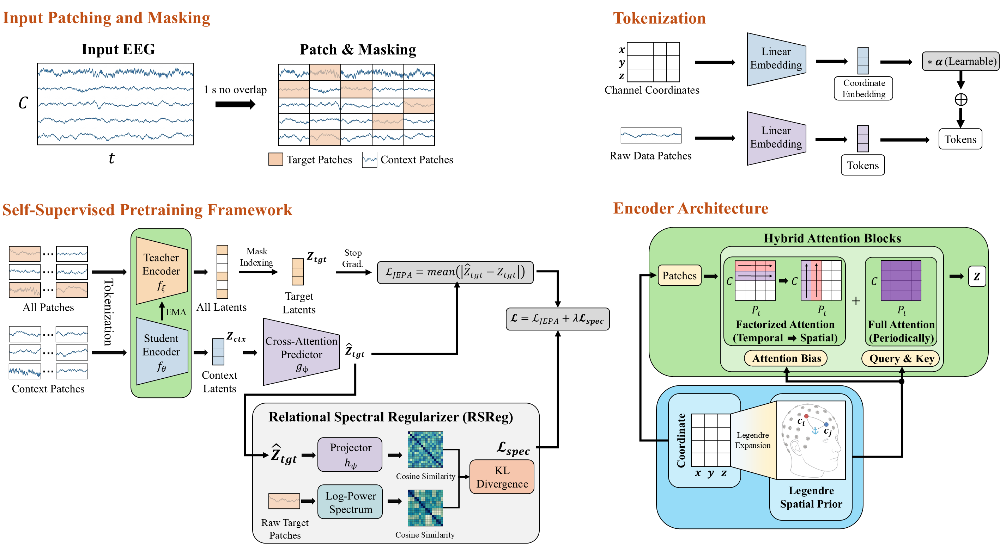

# SPERA

**SPERA: Spherical Prior EEG Foundation Model with Geometry- and Frequency-Aware Latent Prediction**

[](https://arxiv.org/abs/2610.10571)
[](https://arxiv.org/abs/2610.10571)
[](LICENSE)

<p align="center">
  
</p>

<!--
[](https://proceedings.neurips.cc/paper/XXXX)
[](https://huggingface.co/USERNAME/MODEL_NAME)
-->

SPERA (Spherical Prior EEG Representation Architecture) is a JEPA-based EEG foundation model that combines a Legendre spherical prior for electrode geometry, hybrid factorized/full attention, and a relational spectral regularizer. The model is pretrained on approximately **80,000 hours of EEG from 29,048 subjects across 106 datasets** and evaluated across nine downstream tasks.

## Method Overview

- **Hybrid attention:** temporal attention within each channel, followed by spatial attention within each time patch; every fourth block uses full attention.
- **Pairwise Legendre spatial bias** (Eq. 2): a learnable polynomial expansion of electrode cosine similarity, added to factorized spatial-attention scores.
- **Legendre anchor encoding** (Eqs. 3–4): channel geometry features constructed from learnable spherical anchor directions and projected into full-attention queries and keys after temporal RoPE. This introduces geometry–geometry and content–geometry interactions (Appendix F.3).
- **RSReg** (Eq. 5): a relational spectral regularizer that aligns spectral and predicted-latent similarity distributions within each recording. Spectral views use Hann-windowed log-power in the 1–45 Hz band.

Pretrained weights, real datasets, and experiment logs are not included in this repository. Synthetic EEG-like data are provided only for smoke testing; real datasets should be obtained from their original sources and preprocessed as described below.

## Repository Structure

```text
SPERA_EEG/
├── spera/                  # SPERA model implementation
├── configs/
│   ├── model/              # Model-scale configurations
│   └── pretrain/           # Pretraining configurations
├── preprocess/             # Downstream preprocessing scripts
├── example_data/           # Synthetic data utilities for smoke tests
├── figures/                # README figures
├── quickstart.py           # Minimal runnable examples
├── pretrain.py             # Pretraining entry point
├── eval_lpft.py            # Linear probing and LPFT evaluation
└── eval_lpft_seq.py        # Sequence evaluation for ISRUC
```

## Installation

```bash
git clone https://github.com/sees4321/SPERA_EEG.git
cd SPERA_EEG
pip install torch numpy webdataset accelerate tqdm scikit-learn
```

The reference environment used for the paper is Python 3.10, PyTorch 2.10, and CUDA 13.0.

Optional logging:

```bash
pip install wandb
```


## Quickstart

The quickstart contains two minimal examples:

1. Run a downstream-style forward pass with a SPERA encoder. 
(`quickstart.py downstream` only requires PyTorch.)

2. Run a short pretraining smoke test using synthetic WebDataset shards.
(`quickstart.py pretrain` and `pretrain.py` require `accelerate` and `webdataset`.)

### 1. Downstream-style forward pass

```bash
python quickstart.py downstream
```

By default this uses a randomly initialized Tiny encoder from `configs/model/spera_tiny_18m.json`. To load an encoder checkpoint explicitly:

```bash
python quickstart.py downstream --checkpoint_dir ./pretrained_weights/spera_base
```

The checkpoint directory must contain:

```text
./pretrained_weights/spera_base/
  config.json
  pytorch_model.bin
```

For downstream tasks, replace the mock EEG and coordinates with preprocessed EEG segments and electrode coordinates from your dataset.


### 2. Pretraining smoke test

```bash
python example_data/make_synthetic_shards.py --target_shard_size 4MB --length 2000

python quickstart.py pretrain
```

The first command creates synthetic WebDataset shards for the quickstart:

```text
example_data/
  shards.txt
  synthetic-000000.tar
  synthetic-000001.tar
```

Then `quickstart.py pretrain` runs a tiny pretraining smoke test using:

```text
configs/model/spera_tiny_18m.json
configs/pretrain/pretrain_smoke.json
```

The smoke configuration uses five updates, small token budgets, no mixed precision, and no external logging. It writes to `runs/quickstart` and deliberately shortens the schedules so that RSReg is exercised during the test. It is a runtime check, not the paper's training recipe. `--mode downstream` and `--mode pretrain` are also accepted.

You can also run `pretrain.py` directly:

```bash
python pretrain.py \
  --model_cfg configs/model/spera_tiny_18m.json \
  --train_cfg configs/pretrain/pretrain_smoke.json \
  --shards_txt example_data/shards.txt \
  --output_dir runs/quickstart \
  --max_steps 5 \
  --no_wandb
```

With Accelerate:

```bash
accelerate launch --num_processes 1 pretrain.py \
  --model_cfg configs/model/spera_tiny_18m.json \
  --train_cfg configs/pretrain/pretrain_smoke.json \
  --shards_txt example_data/shards.txt \
  --output_dir runs/quickstart \
  --max_steps 5 \
  --no_wandb
```

Expected output:

```text
[params] encoder=...M predictor=...M aux=...M
[step 0000001] l1=... total=... lr=... ema=...
```

## Data Format

SPERA pretraining uses WebDataset tar shards. Each line of `shards.txt` should contain one tar path:

```text
./example_data/synthetic-000000.tar
./example_data/synthetic-000001.tar
```

Each sample inside a shard should contain:

```text
<sample_id>.eeg.npy
<sample_id>.coords.npy
```

with shapes:

```text
eeg.npy    : (num_channels, num_time_samples)
coords.npy : (num_channels, 3)
```

The default sampling rate is 200 Hz, and the default patch length is 1 second.

For example, a 10-second EEG segment sampled at 200 Hz should have:

```text
eeg.shape = (C, 2000)
```

and will produce:

```text
num_patches = 10
num_tokens  = C * 10
```

The provided files in `example_data/` are synthetic EEG-like arrays intended only for testing the data loader and training loop. They are not real EEG recordings and should not be used for scientific evaluation.


## Using Real EEG Data

To train on real EEG data, convert your preprocessed recordings into the same WebDataset format:

```text
<sample_id>.eeg.npy      # float32, shape (C, T)
<sample_id>.coords.npy   # float32, shape (C, 3)
```

Pretraining preprocessing:

- Apply a notch filter at 50 or 60 Hz according to the recording location.
- Bandpass filter to 0.5–75 Hz, then resample to 200 Hz.
- Z-score each channel and clip values to ±15 standard deviations.
- Provide digitized 3D coordinates or coordinates from the corresponding MNE standard montage.
- Segment recordings into non-overlapping 10- or 60-second windows; the loader splits oversized windows into shorter contiguous chunks (preferentially 30 seconds) to respect the 4,096-token limit.

Filtering and signal normalization must be completed before writing shards; the loader expects preprocessed EEG. Downstream datasets follow their own Appendix D protocols; see [preprocess/README.md](preprocess/README.md).


## Pretraining

The supplied full configuration is for **SPERA-Base**: 47,000 updates, 2,350 warmup updates, AdamW, and a global budget of 131,072 target tokens per update. The manuscript's 393,216 input tokens (262,144 context + 131,072 target) are nominal; actual counts depend on masking and batch sizes (Appendix C.2).

| Model | Layers | Hidden dimension | Encoder / predictor heads | Peak LR (`--lr`) |
| --- | ---: | ---: | ---: | ---: |
| Tiny (18M) | 8 | 384 | 4 / 4 | `4e-4` |
| Small (48M) | 12 | 512 | 8 / 8 | `3.5e-4` |
| Base (194M) | 16 | 896 | 14 / 14 | `3e-4` |
| Large (396M) | 25 | 1024 | 16 / 16 | `2.5e-4` |

Full pretraining can be launched with:

```bash
python pretrain.py \
  --model_cfg configs/model/spera_base_194m.json \
  --train_cfg configs/pretrain/pretrain.json \
  --shards_txt /path/to/shards.txt \
  --output_dir runs/spera_base
```

Multi-GPU training:

```bash
accelerate launch pretrain.py \
  --model_cfg configs/model/spera_base_194m.json \
  --train_cfg configs/pretrain/pretrain.json \
  --shards_txt /path/to/shards.txt \
  --output_dir runs/spera_base
```

Useful CLI overrides:

```bash
--max_steps 10000
--tokens_per_batch 4096
--tokens_per_update 65536
--lr 3e-4
--num_workers 8
--resume_from runs/spera_base/step_0010000
--no_wandb
```


## Loading a Pretrained Encoder

```python
from spera.encoder import EEGEncoder

model = EEGEncoder.from_pretrained(
    "./runs/spera_base/final/student/",
    map_location="cuda",
)
model = model.to("cuda").eval()
```

Then encode EEG with:

```python
z = model(eeg, coords)
```

where:

```text
eeg.shape    = (B, C, T)
coords.shape = (B, C, 3)
z.shape      = (B, C * P, D)
```

For classification, a simple baseline is mean pooling over tokens:

```python
features = z.mean(dim=1)
logits = classifier(features)
```

## Downstream LPFT (Linear Probing then Fine-Tuning)

```bash
python eval_lpft.py \
  --data_root /path/to/task \
  --pretrained ./pretrained_weights/spera_base/ \
  --n_classes 4 \
  --amp
```

This runs linear probing on a SPERA encoder using a downstream classification dataset. The dataset directory must contain `train`, `validation`, and `test` subfolders, each with:

```text
/path/to/task/
  train/
    eeg.npy        # (N, C, T)
    coords.npy     # (N, C, 3)
    label.npy      # (N,)
  validation/
    ...
  test/
    ...
```

The script mean-pools tokens and applies LayerNorm followed by a linear classifier. It trains the head while keeping the encoder frozen, selects the best checkpoint by validation balanced accuracy, and reports test metrics. For binary tasks it logs balanced accuracy, AUROC, and AUC-PR (average precision); for multi-class tasks it logs balanced accuracy, weighted F1, and Cohen's kappa.

To also run a fine-tuning phase after linear probing (the "FT" in LPFT), add `--do_ft`:

```bash
python eval_lpft.py \
  --data_root /path/to/task \
  --pretrained ./pretrained_weights/spera_base/ \
  --n_classes 4 --amp --do_ft \
  --lp_lr 1e-3 --ft_lr 1e-5 \
  --lp_epochs 20 --ft_epochs 20
```

Multi-GPU training uses `torchrun` (single-GPU runs work without it):

```bash
torchrun --nproc_per_node=2 eval_lpft.py \
  --data_root /path/to/task \
  --pretrained ./pretrained_weights/spera_base/ \
  --n_classes 4 --amp --do_ft
```

Logging defaults to Weights & Biases. Pass `--no_wandb` to write `metrics.csv` to the output directory instead:

```bash
python eval_lpft.py \
  --data_root /path/to/task \
  --pretrained ./pretrained_weights/spera_base/ \
  --n_classes 4 --amp --no_wandb
```

The model selection metric defaults to balanced accuracy. Use `--selection_metric kappa` (multi-class) or `--selection_metric auroc` (binary) to select by a different metric.

Expected output:

```text
[LP] trainable params: ...
[BEST] phase=lp epoch=... val_bacc=...
[TEST] {'bacc': ..., 'f1w': ..., 'kappa': ...}
```

The held-out test set is evaluated once after validation-based checkpoint selection; its metrics are logged under `test/`. CLI defaults are example settings, not a released task-specific hyperparameter search. To reproduce the five-seed reporting protocol, repeat each task with five fixed seeds. Compute the nine-task unweighted average separately for each seed before reporting the mean and standard deviation across seeds.

### ISRUC sequence evaluation

Appendix D.5 also evaluates sequences of 20 consecutive 30-second epochs:

```bash
python preprocess/preprocess_isruc.py --root_dir /path/to/isruc \
  --output_dir /path/to/isruc_seq --sequence --seq_len 20
python eval_lpft_seq.py --data_root /path/to/isruc_seq \
  --pretrained ./pretrained_weights/spera_base --n_classes 5 --do_ft --no_wandb
```

Sequence arrays have shapes `(N, 20, 6, 6000)`, `(N, 20, 6, 3)`, and `(N, 20)` for EEG, coordinates, and labels. This script trains a one-layer Transformer sequence head, including during its frozen-encoder phase. Use `eval_lpft.py` with non-sequence preprocessing for single-segment linear probing.

## Citation

If you use SPERA in your research, please cite:

```bibtex
@article{kim2026spera,
  title={SPERA: Spherical Prior EEG Foundation Model with Geometry-and Frequency-Aware Latent Prediction},
  author={Kim, Minsu and Kim, Ye-Sung and Jeon, Hyeseong and Hyung, Wooseok and Lee, Joshua and Im, Chang-Hwan},
  journal={arXiv preprint arXiv:2610.10571},
  year={2026},
  note={Accepted at NeurIPS 2026}
}
```

## License

The source code in this repository is licensed under the [PolyForm Noncommercial License 1.0.0](LICENSE).

Noncommercial use, modification, and redistribution are permitted under the license terms. The license also expressly permits use by educational institutions and public research organizations, regardless of their source of funding or obligations resulting from that funding. See [LICENSE](LICENSE) for the full terms and permitted purposes.

For commercial use outside these permissions, contact the [repository maintainer](https://github.com/sees4321) to arrange a separate commercial license.

Dataset usage is subject to the licenses and data-use agreements of the original data providers.
